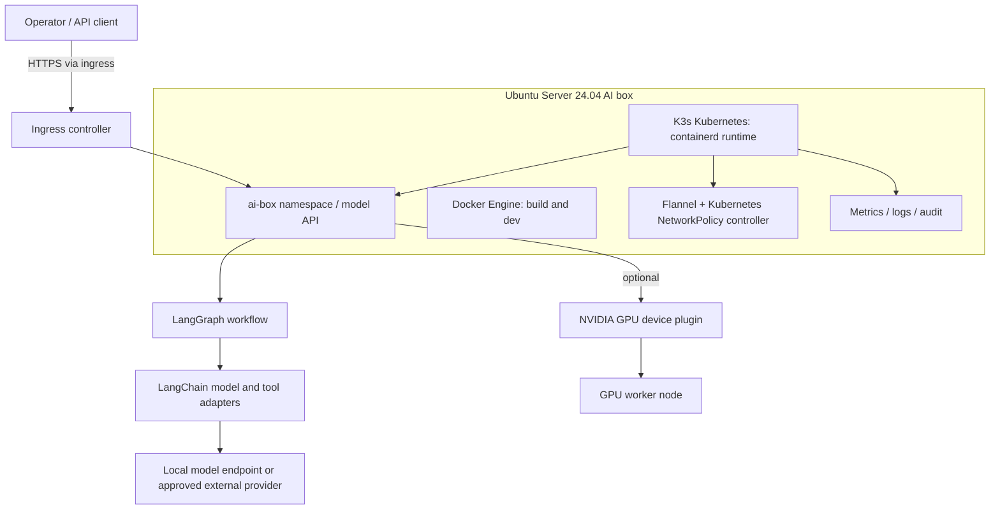

# AI Box Infrastructure & MLOps

An infrastructure reference for running private ML and LLM workloads on a self-managed AI box. It covers host setup, Docker image builds, Kubernetes deployment, Python, LangChain and LangGraph, workload isolation, optional NVIDIA GPU scheduling, and operational resilience.

This repository turns the [AI infrastructure & MLOps case study](https://mrsingh.driftdrape.com/projects/ai-box-mlops) into a reproducible implementation blueprint. The public case study does not specify hardware, employer, dates, or benchmark results; this repository therefore documents a configurable reference build and does not claim those missing details.

## What is included

- Ubuntu Server 24.04 LTS host preparation and a post-install bootstrap script.
- Docker Engine for image builds and standalone development. K3s uses its bundled containerd runtime for Kubernetes pods.
- Single-node K3s Kubernetes cluster with a path to a multi-node cluster.
- FastAPI example service using Python, LangChain, and LangGraph.
- Kubernetes namespace, resource limits, probes, and default-deny network policy examples.
- Optional NVIDIA GPU Operator path and a GPU-targeted inference workload example.
- Deployment, security, operations, recovery, load-test, and chaos-test documentation.

## Architecture



See [docs/architecture.md](docs/architecture.md) for trust boundaries, traffic flows, and deployment choices.

## Quick start

### 1. Prepare a machine

Use the [hardware and OS guide](docs/host-setup.md). The documented baseline is a dedicated x86_64 machine with Ubuntu Server 24.04 LTS, 4+ CPU cores, 16+ GB RAM, and SSD storage. For GPU workloads, use a supported NVIDIA GPU and current data-center driver. This is a reference baseline, not a performance guarantee.

### 2. Bootstrap the host

Log in as a sudo-capable user and run:

```bash
git clone https://github.com/clouddevops-singh/ai-box-mlops.git
cd ai-box-mlops
sudo ./scripts/bootstrap-ubuntu.sh
```

The script installs Docker Engine, configures firewall defaults, and installs K3s. It prompts before applying host firewall changes. Review [docs/deployment.md](docs/deployment.md) before exposing any service. To skip K3s or Docker, pass `--skip-k3s` or `--skip-docker`.

### 3. Access Kubernetes

```bash
mkdir -p "$HOME/.kube"
sudo install -m 0600 -o "$USER" -g "$(id -gn)" /etc/rancher/k3s/k3s.yaml "$HOME/.kube/config"
kubectl get nodes -o wide
```

### 4. Build and deploy the example API

```bash
docker build -t ai-box-api:dev ./app
docker save ai-box-api:dev | sudo k3s ctr images import -
kubectl apply -k deploy/base
kubectl -n ai-box port-forward svc/ai-box-api 8080:80
```

In another terminal:

```bash
curl http://127.0.0.1:8080/healthz
curl -X POST http://127.0.0.1:8080/chat \
  -H 'Content-Type: application/json' \
  -d '{"message":"Explain how GPU scheduling works in Kubernetes."}'
```

The sample uses a deterministic local graph and makes no external model calls. Configure a real model adapter only after reviewing [security guidance](docs/security.md).

### 5. Enable GPU scheduling (optional)

Follow [docs/gpu-scheduling.md](docs/gpu-scheduling.md) to install an NVIDIA driver and GPU Operator. Then deploy the optional GPU example:

```bash
kubectl apply -k deploy/gpu
kubectl -n ai-box get pods -o wide
```

The GPU example is a scheduling demonstration. It needs an image that contains CUDA and a workload configured to use it; a GPU resource request alone does not accelerate an application.

## Repository map

```text
app/                  FastAPI + LangChain/LangGraph reference service
docs/                 Architecture, host, deployment, GPU, network, operations
deploy/base/           Kubernetes base manifests and network policies
deploy/gpu/            Optional GPU workload overlay
scripts/               Host bootstrap and validation helpers
```

## Deployment models

| Model | Use | Notes |
|---|---|---|
| Single-node AI box | Lab, portfolio demo, edge inference | K3s control plane and workloads share one host; host failure takes down the cluster. |
| Small multi-node cluster | Team or internal service | Use three server nodes for embedded etcd HA, separate GPU workers, stable API VIP/load balancer, and shared or replicated storage. |
| Production platform | Sensitive or business-critical workloads | Add identity, secret management, backups, image signing/scanning, external observability, tested restore, and a managed change process. |

## Security and limits

- Keep the Kubernetes API private; do not publish port 6443 to the internet.
- NetworkPolicy enforcement requires a compatible CNI/controller. Validate the installed K3s network policy controller before relying on policies.
- The example API has no authentication and must not be exposed publicly as-is.
- Secrets belong in a secret manager or Kubernetes Secret populated at deploy time; never commit real keys.
- The bootstrap script changes host packages, firewall rules (with confirmation), and cluster state. Read it before running.
- Treat GPU driver, CUDA, Kubernetes, and framework compatibility as a versioned matrix; pin and validate versions for your hardware before production use.

## Documentation

- [Architecture](docs/architecture.md)
- [Hardware and OS installation](docs/host-setup.md)
- [Deployment guide](docs/deployment.md)
- [GPU scheduling](docs/gpu-scheduling.md)
- [Network isolation](docs/network-isolation.md)
- [Security](docs/security.md)
- [Operations and resilience](docs/operations.md)
- [Application and Python environment](docs/application.md)

## License

MIT. See [LICENSE](LICENSE).
