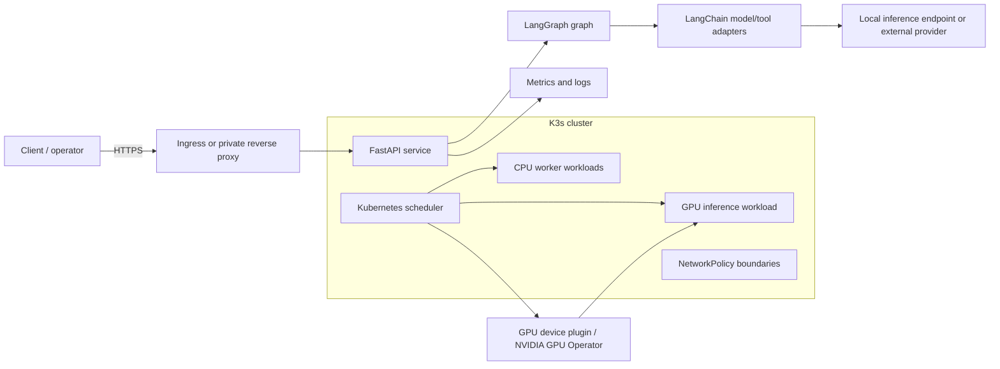

# Architecture

## Goals

The system provides a repeatable local platform for ML model and service API workloads. Kubernetes schedules CPU and optional GPU workloads. Docker builds images. The Python service demonstrates LangChain integrations coordinated by a LangGraph workflow. Network policies express workload boundaries, and the operations guide describes load and failure testing.

## Logical view

## Physical reference deployment

The default footprint is one x86_64 Ubuntu Server 24.04 LTS machine. K3s runs the control plane and application pods on that host. K3s uses containerd to run pods; Docker Engine is installed for familiar image build workflows and optional Compose-based local development. The two runtimes are separate and do not share images automatically. The quick-start explicitly imports images into K3s.

For a multi-node installation, use three K3s server nodes with embedded etcd for control-plane quorum, then add CPU/GPU agents. Keep the API endpoint on a stable private VIP or load balancer. A GPU should normally be attached to a worker node so ordinary control-plane and API work does not consume accelerator capacity.

## Trust boundaries and traffic

| Boundary | Allowed flow | Control |
|---|---|---|
| Admin network → host | SSH from a restricted management subnet | Host firewall, SSH keys, no password SSH |
| Admin network → Kubernetes API | TCP 6443 from trusted admins only | Firewall and kubeconfig protection |
| Client → API | HTTPS through a private ingress or gateway | TLS, authentication, request limits |
| Namespace → DNS | UDP/TCP 53 to cluster DNS | NetworkPolicy allow rule |
| API → model endpoint | Only required model service or provider endpoints | Egress policy, proxy/egress gateway where feasible |
| Workload → workload | Explicit service-to-service flows only | Namespace default-deny and scoped policies |
| Pod → host / metadata | Deny unless an explicit node service requires it | CNI policy, pod security, host firewall |

Kubernetes NetworkPolicy is additive. A default-deny policy takes effect only when a network policy implementation is enforcing it. K3s includes a network policy controller by default; confirm this configuration remains enabled and validate policy behavior in the target network before trusting the boundary.

## GPU scheduling flow

The NVIDIA GPU Operator installs and manages GPU drivers (when configured), container toolkit integration, device plugin, and related components. The device plugin advertises `nvidia.com/gpu` on eligible nodes. A pod requests a whole GPU in `resources.limits`; the scheduler places it on a node with sufficient allocatable GPU resources. See [gpu-scheduling.md](gpu-scheduling.md).

## Resilience and observability

Use readiness and liveness probes to gate traffic and restart stuck processes. Set requests and limits so the scheduler can account for capacity. Track API latency, error rate, CPU/memory use, GPU utilization/memory, pod restarts, node pressure, and disk usage. Test failure scenarios on a non-production cluster before adopting disruption or chaos tooling.

## Design limits

- A single-node installation is not highly available: it has no control-plane quorum and no node failover.
- Local-path storage is tied to a node and is not a backup. Backups must be stored off-host and restore-tested.
- The sample graph is deterministic and does not ship a model, vector database, or provider credential.
- Performance and availability claims require measurements on the actual hardware and workload; none are claimed here.
